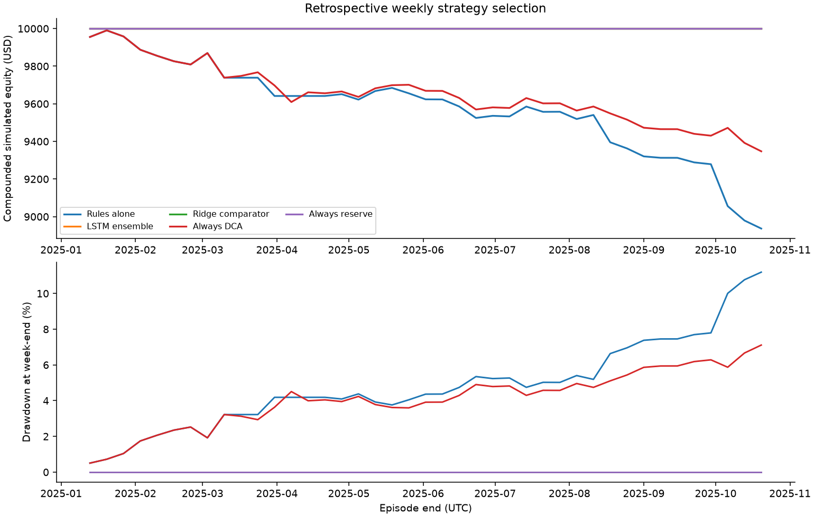
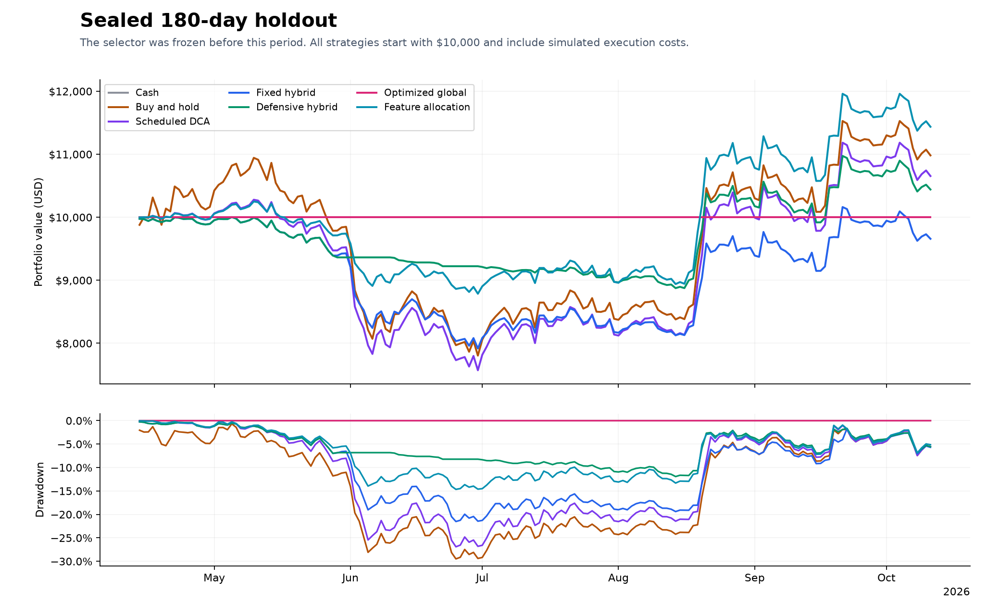

# Bitcoin Trading Agent: DCA, ATR and LSTM Research

A reproducible Python project comparing Bitcoin accumulation, conditional swing trading and cash reserves, developed for the [Apziva AI Residency project](https://go.apziva.com/project/detail/36/).

The project asks: **assuming Bitcoin remains operational and tradable, can a configurable strategy improve return and drawdown relative to simpler alternatives, including during prolonged declines?** Profitability is evaluated rather than assumed. All execution is simulated; there is no funded exchange broker.

<!-- PROJECT_STATUS_START -->
**Status as of 22 October 2026:** source, historical strategy research and the requested LSTM comparison are implemented. **Real Telegram BUY/SELL delivery was verified with synthetic trades. Gmail still needs Google authorization, and continuous 24/7 operation was not achieved.** The real-data log preserves interruptions and separate accounts. GitHub publication was newly authorized by the owner; YouTube was waived. Read the [requirements audit](reports/submission/requirements.md), [LSTM result](reports/lstm-comparison/review.md) and [real-data log](reports/real-data-evaluation/review.md) before interpreting the project as fully validated.
<!-- PROJECT_STATUS_END -->

[LSTM comparison](reports/lstm-comparison/review.md) | [Requirements audit](reports/submission/requirements.md) | [Formula guide](docs/modeling-guide.md) | [Telegram/Gmail setup](docs/notification-setup.md) | [Real-data logs](reports/real-data-evaluation/review.md)

**Verified:** all 117 tests passed locally and on GitHub's Linux runner. The Docker image built and its configuration command passed in [GitHub Actions](https://github.com/Abdulrahmanos/qytbcf1pULIvwxUO/actions/runs/39750052488). This verifies packaging, not cloud uptime or external delivery.

## Problem and scope

DCA spreads purchases over time but can keep accumulating through a prolonged decline. Swing trading adds entry and exit rules but incurs more execution costs. A cash reserve reduces participation in both losses and rallies. This project makes those tradeoffs explicit and preserves the data, settings, decisions and accounting needed to examine them.

Two policies are kept separate:

- **Historical research:** chronological parameter search over DCA/swing/reserve profiles, with a frozen final holdout.
- **Operational paper strategy:** explicit regime, spending, exposure, exit and recovery rules. The historical winner is not automatically deployed, and no LLM controls trades.

## Historical findings

### Requested LSTM comparison

A separate retrospective experiment asks whether an LSTM improves the **choice between DCA, swing and reserve**. It predicts the next week's net utility of three fixed allocation modes from 30 completed daily observations. Rules, a ridge model and the LSTM share the same action set, simulator and costs. Training outcomes end before 2024, validation uses 2024, and the retained test covers 41 complete weeks from 6 January to 20 October 2025. Strict missing-data filtering excludes later periods; the archive itself extends into October 2026. These prices were already inspected during earlier research, so this is not a pristine project-level holdout.

| Weekly selection policy | Net return | Hourly maximum drawdown | Result |
| --- | ---: | ---: | --- |
| Rules alone | -10.63% | 11.49% | 32 DCA, 4 swing and 5 reserve weeks |
| LSTM, three-seed ensemble | 0.00% | 0.00% | Chose reserve in all 41 weeks |
| Always reserve | 0.00% | 0.00% | Same result without a model |

**The LSTM did not demonstrate added value over simply holding cash.** It avoided the rule policy's losses but produced no trading profit. Its separate price-direction forecast was correct in 46.3% of test weeks; a zero-return forecast had lower absolute error. All three fixed seeds are reported, not just a selected winner.



The experiment liquidates at each week's end, includes 0.6% fees and 0.1% adverse slippage per fill, and uses the legacy historical strategy rules. It is not the continuously held operational account. Weekly resets and legacy swing targets can make active trading unattractive after costs; this result does not establish that every DCA or swing implementation is inferior. See the [protocol](docs/lstm-experiment.md), [per-week predictions](reports/lstm-comparison/test-predictions-and-decisions.csv), [model summary](reports/lstm-comparison/summary.json) and [full review](reports/lstm-comparison/review.md).

```powershell
.\.venv\Scripts\python.exe -m pip install -r requirements-research.lock.txt -r requirements-lstm.txt
.\.venv\Scripts\python.exe -m research_lstm.run
```

The completed run installed PyTorch separately under ignored `var/lstm-libs` to preserve the old collector's libraries. Normal installations can use the requirements above. Reproduction also needs the archived historical CSV or the data-download command below; a new API download can differ from the recorded checksum.

### Earlier continuous-inventory research

The archived final holdout covers **14 April to 10 October 2026**, with $10,000 initial cash, no later deposits, modeled costs and final liquidation. These results describe the historical research policies, not the revised operational strategy.

| Research strategy | Net return | Maximum drawdown | Final equity |
| --- | ---: | ---: | ---: |
| Cash | 0.00% | 0.00% | $10,000.00 |
| Buy and hold | 9.82% | 29.48% | $10,981.91 |
| Scheduled DCA | 6.54% | 26.90% | $10,654.37 |
| Swing only | -20.64% | 20.64% | $7,935.95 |
| Fixed hybrid | -3.42% | 21.51% | $9,658.43 |
| Defensive hybrid | 4.41% | 11.92% | $10,440.87 |
| Optimized global | 0.00% | 0.00% | $10,000.00 |
| Feature allocation | 14.37% | 14.66% | $11,436.56 |



The feature selector's longer development history reached **72.30% drawdown**. Its favorable recent holdout does not establish a deployable optimum. The final global ranking selected cash. The original swing rule lost money after costs, motivating net-cost targets and disabled swing entries in the operational run.

Full comparisons, funding assumptions and chronology are in the [research report](reports/milestone-2/review.md), [summary](reports/milestone-2/summary.json) and [verification record](reports/milestone-2/verification.json). The holdout has now been observed; future revisions need new independent validation.

## Data and evaluation methodology

1. **Collect and audit public data.** The archived input contains 59,384 Coinbase BTC-USD hourly candles from 1 January 2020 through 10 October 2026. Sixteen missing hours remain documented; prices are not imputed.
2. **Calculate causal features.** Hourly ATR, moving averages, breakouts and relative volume use completed observations. Daily context becomes available after that UTC day ends. Short hourly indicators restart after gaps.
3. **Declare candidate settings.** The search compares 47 distinct profiles after removing irrelevant duplicates, varying allocations, 3%/6% dip thresholds, 1.5/2.5 ATR multipliers and defensive DCA exits.
4. **Fit chronologically.** Development uses 23 nonoverlapping 90-day episodes and 20 walk-forward fits. A fit sees only completed earlier episodes within its two-year training window.
5. **Rank risk and return together.** The objective is `mean(log(1 + net_return)) - 0.75 * mean(max_drawdown)`. The penalty is a declared research preference. Regime-specific selection needs at least three matching earlier episodes; otherwise it uses the global ranking.
6. **Freeze the final selector.** The last 180 days use a previously fitted mapping. Funding, idle cash, fees, slippage and terminal liquidation enter the comparison.
7. **Audit separately.** Exported fills reconcile cash and inventory for all 18 strategy-period comparisons, while model timestamps and input checksums check chronology and provenance.

## Operational strategy

The [paper configuration](config/paper.json) and [forward configuration](config/forward.json) start with **$10,000**. Allocation percentages are budget targets, not immediate BTC investments.

| Daily regime | DCA target | Swing target | Reserve target |
| --- | ---: | ---: | ---: |
| Bull | 50% | 30% | 20% |
| Mixed | 30% | 20% | 50% |
| Bear, high volatility or unknown | 0% | 0% | 100% |

Bull requires price above its 200-day average and positive 30-day momentum; bear requires both below. High volatility uses daily ATR above 6% of closing price. Available cash is reviewed every 24 hours against target deficits and existing holdings. Positions are sold through explicit exit rules.

- **DCA:** scheduled purchases approximately every 24 hours or an eligible 3% dip from the last actual DCA fill, with a shared 12-hour cooldown. A tranche is 2% of the current DCA reference budget; the rolling seven-day spending cap is 14%, including fees. A $5,000 reference therefore permits approximately $100 per purchase and $700 per rolling week.
- **Swing:** implemented but disabled in the forward run. The candidate entry requires EMA20 above EMA50, a breakout above the prior 20-hour high and relative volume of at least 1.5. Position risk is limited to 0.5% of equity under modeled stop execution, with a 1.5-ATR stop, net 2R target, 72-hour time exit and an 8-ATR target-distance filter.
- **Portfolio controls:** new buys respect 60% maximum BTC exposure and 20% minimum cash. Holdings are trimmed above 62% exposure. Rapid declines, seven confirmed bearish days, active-period drawdown and the original-capital floor can request liquidation. Recovery requires cooldown and distinct qualifying bullish days.

Exit thresholds request actions; price gaps, stale data or an unavailable market can delay execution and produce larger losses. The [modeling guide](docs/modeling-guide.md) derives position sizing, fee-adjusted targets, drawdown, recovery and cash redistribution with saved examples.

## Execution and accounting

Paper buys use the public ask and sells use the bid, with **0.6% modeled fees and 0.1% adverse slippage per fill**. These are simulation assumptions, not a verified exchange-account fee tier. Runtime arithmetic uses Decimal, observed product increments, conservative rounding, cash/inventory reservations and partial fills. The $1,000 per-quote fill cap is an artificial simulator limit.

Orders, fills, positions and risk state persist transactionally in SQLite. Quote replay and restart protection prevent reapplying the same observation. Independent audits reconstruct holdings and cash from fills.

```text
mark = (bid + ask) / 2
portfolio equity = USD cash + BTC units * mark
net return = equity / initial funding - 1
drawdown = 1 - equity / previous peak equity
```

Operational equity marks open positions without deducting a hypothetical final exit. Historical research includes terminal liquidation costs. Cash earns no interest, and the experiments assume no borrowing, leverage or later deposits.

## Reproduce locally

Python 3.11 or newer is required. The recorded Windows research environment uses **Python 3.14.6**; pinned dependency files record its package versions. A clean Python 3.14 installation with those research dependencies passed all 117 tests on GitHub's Linux runner.

On Windows PowerShell, from the project root:

```powershell
py -3.14 -m venv .venv
.\.venv\Scripts\python.exe -m pip install -r requirements-research.lock.txt
.\.venv\Scripts\python.exe -m bitcoin_agent validate-config
.\.venv\Scripts\python.exe -m unittest discover -s tests -v
```

For another supported Python version, install compatible research dependencies with `python -m pip install -e ".[research]"` and record the resulting environment. Foundation commands use the standard library; feature construction needs NumPy and pandas, and figures need matplotlib.

To initialize and inspect an operational paper account:

```powershell
.\.venv\Scripts\python.exe -m bitcoin_agent paper-init
.\.venv\Scripts\python.exe -m bitcoin_agent paper-status
.\.venv\Scripts\python.exe -m bitcoin_agent paper-audit
.\.venv\Scripts\python.exe -m bitcoin_agent run-paper --cycles 3
```

Public-data commands require internet access. Research and live warm-up fetch/cache market observations under ignored local directories. Repeated initialization preserves balances. Use a separate database when changing initial funding or starting a different experiment.

To reproduce the archived research:

```powershell
.\.venv\Scripts\python.exe -m bitcoin_agent fetch-data --start 2020-01-01 --end 2026-10-11
.\.venv\Scripts\python.exe -m bitcoin_agent research
.\.venv\Scripts\python.exe tools/verify_research.py
.\.venv\Scripts\python.exe -m bitcoin_agent render-report
```

A new API download may differ from the archived checksum. Raw data, cached API pages and large per-hour/fill CSVs are excluded from Git. The commands regenerate research outputs locally; saved summaries, rankings, figures and audit records are included for inspection.

## Local deployment and forward evaluation

The [AWS deployment guide](docs/cloud-evaluation.md) now uses a free local Qwen2.5-0.5B model with a pinned CPU runtime and verified weights through [compose.evaluation.yaml](compose.evaluation.yaml). No OpenAI key or paid inference service is needed. The server image and public market-feed preflight passed; the new model still needs its real server check. **The new prospective week has not started, and no completed week is claimed.** Model advice remains separate from rule-controlled paper trades.

The Windows deployment includes single-worker supervision, logon startup, freshness monitoring, bounded restart backoff and independently audited SQLite backups. Docker/Compose packaging passed an actual Linux CI build and container configuration check; Docker is unavailable on the development Windows host. No cloud deployment was performed. Use the [ordinary continuous-service instructions](docs/project-report.md#local-or-cloud-startup) for a new deployment; the old timed experiment is archived.

The forward candidate and scheduled-DCA, buy-and-hold and cash books use the same prospective observations and modeled costs. Historical candles only warm indicators; they never replace missing prospective observations. Each of seven 24-hour days must reach at least 99% quote-age coverage, with no configuration change or recorded observer-integrity failure.

<!-- FORWARD_STATUS_START -->
The replacement window was declared for **19-26 October 2026 at 12:12:29 Asia/Riyadh**, but repeated standby/hibernation caused gaps and it cannot pass its original reliability protocol. It was stopped on 22 October with its balances and observations preserved. The earlier account and recovery rehearsal remain separate. The exported [real-data evaluation](reports/real-data-evaluation/review.md) spans 11–22 October across distinct accounts and explicitly reports missing periods. This is not a successful uninterrupted week of operation. The 99% daily threshold was an added project criterion, not a numerical threshold in the supplied Apziva brief.
<!-- FORWARD_STATUS_END -->

The corrected task runs without a console window, retries a stopped supervisor on a one-minute schedule for eight days, and holds a Windows idle-sleep prevention request only while active. The display can sleep. Intentional sleep, lid closure, power loss, shutdown and disconnection can still interrupt observation. No permanent power-plan setting was changed.

Existing local deployment controls:

```powershell
.\.venv\Scripts\python.exe -m bitcoin_agent health
.\.venv\Scripts\python.exe -m bitcoin_agent forward-audit
.\.venv\Scripts\python.exe -m bitcoin_agent forward-report
.\deploy\windows\Stop-PaperRun.ps1
```

These inspect an existing local run; its runtime files are not included in a fresh clone. Read the [deployment guide](docs/deployment.md) before starting supervision. Source, configuration and calculation-library versions are frozen during an experiment. A desktop deployment needs the computer awake, signed in and online.

## Integration demonstrations

The [local demo inbox](reports/milestone-4/inbox/index.html) shows saved paper trade alerts and a weekly report without email, Telegram or paid APIs. The code includes restricted Google Sheet controls, a persistent notification outbox and bounded shadow-adviser adapters.

Real Telegram delivery passed an isolated synthetic BUY/SELL test through the persistent fill outbox, with provider receipts and no duplicate messages on re-scan; see the [verification record](reports/submission/telegram-verification.json). Gmail delivery, runtime Google Sheet OAuth and actual LLM calls remain unverified. The demo adviser is an explicitly labeled deterministic fixture. No LLM response changes orders or risk settings. Google configuration edits and LLM advice are disabled in the frozen forward run; notification delivery is local.

See the [integration guide](docs/integrations.md) for configuration and recovery behavior. Credential names are listed in [.env.example](.env.example); populated credentials and private Sheet identifiers stay local.

## Repository guide

| Location | Purpose |
| --- | --- |
| [bitcoin_agent/](bitcoin_agent/) | Configuration, features, research simulator, Decimal paper engine, integrations and supervision |
| [config/](config/) | Nonsecret funding, strategy, research and demo settings |
| [tests/](tests/) | Causality, accounting, execution, restart, integration and coverage checks |
| [reports/milestone-2/](reports/milestone-2/review.md) | Historical comparisons, parameter search, figures and audit evidence |
| [reports/milestone-3/](reports/milestone-3/review.md) | Operational verification and constructed stress paths |
| [reports/milestone-4/](reports/milestone-4/review.md) | Local message/report demo and integration verification |
| [reports/milestone-5/](reports/milestone-5/review.md) | Original deployment checkpoint and dated forward status |
| [docs/modeling-guide.md](docs/modeling-guide.md) | Equations and worked examples |
| [docs/milestones.md](docs/milestones.md) | Delivered work and remaining acceptance requirements |
| [deploy/windows/](deploy/windows/) | Start, stop, logon-task installation and recovery-check scripts |
| [Dockerfile](Dockerfile), [compose.yaml](compose.yaml) | CI-verified image build and configuration check; long-running deployment unverified |
| `var/`, `data/`, `.venv/` | Local runtime state, source data and environment; excluded from Git |

The recorded 16 October verification passed **98 automated tests**, including actual Windows worker-process ownership. Those tests verify implementation behavior on defined cases; they do not substitute for seven days of prospective observations.

The 19 October runtime recovery revision passed 101 implementation tests. The 22 October suite passes 117 tests, including the LSTM chronology checks and container health behavior. The 24 October cloud preparation passes 127 local tests, including ten new isolation/integrity checks. Actual cloud uptime and real OpenAI responses remain unverified. Additional finalization checks preserve the failed prospective experiment; source publication follows the owner's renewed GitHub authorization. No other uploads are authorized.

## Walkthrough and finalization

The optional [walkthrough script](reports/walkthrough/script.md) is an earlier preview explaining budgets, causal indicators, costs, swing sizing, historical findings, defensive exits and evaluation. Its original incomplete label is preserved; the interrupted week did not pass. MP4 files stay local and out of source control. YouTube and public video URLs were waived by the owner; [submission settings](config/submission.json) authorize GitHub source publication only.

Media generation uses a separate ignored folder, preserving the frozen trading environment:

```powershell
.\.venv\Scripts\python.exe -m pip install --target var/media-libs --no-deps -r requirements-walkthrough.lock.txt
.\.venv\Scripts\python.exe -B tools/create_walkthrough.py --render
```

Offline narration requires PowerShell 7 with System.Speech and Microsoft David Desktop. The historical finalization helper still rejects the failed prospective week. GitHub source and the truthful reports have been published; no video or Apziva submission was uploaded.

## Remaining work and limitations

<!-- COMPLETION_WORK_START -->
- Complete Gmail authorization and verify its real provider receipt using the [setup guide](docs/notification-setup.md). Telegram BUY/SELL provider receipts are verified; bot credentials and the numeric chat ID stay local.
- Verify runtime Google Sheet OAuth separately. The free local LLM has a pinned model and CPU runtime; its actual server inference preflight and seven-day collection remain to be verified. Shadow suggestions do not control trades.
- Validate uninterrupted operation on an always-available host before claiming 24/7 reliability. The old failed week remains preserved.
- GitHub source publication is authorized. Apziva submission remains the owner's action; YouTube is waived.
<!-- COMPLETION_WORK_END -->
- Validate any proposed strategy revision on newly reserved data. The observed historical holdout is diagnostic data for later changes.
- Treat the coarse regime model, small context samples and severe development drawdown as limitations. No durable profitability or universally optimal allocation has been established.
- Keep operational reliability separate from investment performance. A seven-day successful run would establish behavior over those conditions, not long-term investment merit.

The repository identifier specified by the project brief is `qytbcf1pULIvwxUO`.

The 25 October free-model revision passes 142 local tests. Linux CI additionally runs real CPU inference with explicitly synthetic context; that test is separate from a real-data forward week.
