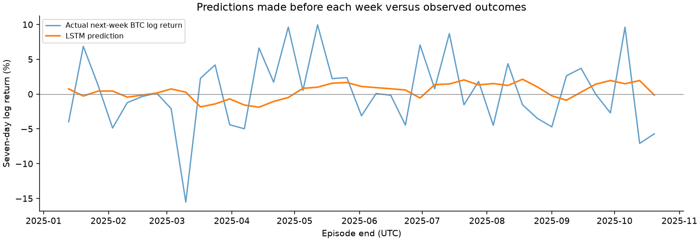

# Does an LSTM improve DCA / swing / reserve selection?

**The LSTM chose reserve in every test week. It avoided rules' losses but matched the no-model cash baseline; no added value over always-reserve was demonstrated.**

This is a retrospective experiment, not a pristine unseen project-level holdout or a deployed trading model.

Test: 2025-01-06T00:00:00+00:00 to 2025-10-20T00:00:00+00:00; 41 complete, nonoverlapping weeks. Training: 100 weeks; validation: 52 weeks.

## Profit and risk

| Policy | Net return | Hourly max drawdown | Fees USD | DCA / swing / reserve weeks |
| --- | ---: | ---: | ---: | --- |
| Rules alone | -10.63% | 11.49% | 934.06 | 32 / 4 / 5 |
| LSTM ensemble | 0.00% | 0.00% | 0.00 | 0 / 0 / 41 |
| Ridge comparator | 0.00% | 0.00% | 0.00 | 0 / 0 / 41 |
| Training-average mode | 0.00% | 0.00% | 0.00 | 0 / 0 / 41 |
| Always DCA | -6.53% | 7.43% | 595.29 | 41 / 0 / 0 |
| Always swing | -31.35% | 31.35% | 2689.13 | 0 / 41 / 0 |
| Always reserve | 0.00% | 0.00% | 0.00 | 0 / 0 / 41 |
| LSTM seed 17 | 0.00% | 0.00% | 0.00 | 0 / 0 / 41 |
| LSTM seed 29 | 0.00% | 0.00% | 0.00 | 0 / 0 / 41 |
| LSTM seed 43 | 0.00% | 0.00% | 0.00 | 0 / 0 / 41 |

## Prediction versus actual

The model predicts each mode's next-week utility plus a separate BTC log return. The highest predicted utility chooses the mode. Forecast accuracy and trading profitability are separate questions.

| Forecast | Mean absolute log-return error | Direction accuracy |
| --- | ---: | ---: |
| LSTM ensemble | 4.262 percentage points | 46.3% |
| Ridge comparator | 4.245 percentage points | 53.7% |
| Zero return | 3.978 percentage points | Not applicable (predicts zero) |

## Evidence strength

The paired mean weekly log-return difference (LSTM minus rules) is 0.2742 percentage points; the four-week-block 95% interval is [0.1139, 0.4150]. This is an exploratory uncertainty estimate, not proof of durable profitability.

Three fixed seeds are all shown; the primary policy averages their predictions. Validation MSE alone selects the epoch. The test never selects seeds, thresholds, stopping epochs or the preferred conclusion.

## What was held constant

The rules baseline and LSTM choose the same three allocation profiles: 90% DCA, 90% swing, or full reserve. A 10% reserve accompanies the first two modes. Both use identical hourly prices, entry/exit rules, 0.6% fees and 0.1% adverse slippage per fill. A swing allocation waits for the existing breakout/volume signal. Every complete week begins in cash and ends with liquidation; returns compound across weeks.

The model uses 30 completed daily observations of returns, volatility, range, relative volume and moving-average distances. Incomplete periods are excluded, never filled. The strict 200-day complete-close feature history also excludes long stretches after a missing daily input; the resulting test ends in October 2025 although the archive extends into October 2026. The old operational paper account is untouched.

## Limits

- Previously inspected historical archive; retrospective model test only.
- Small weekly sample and one cryptocurrency; no hyperparameter search or fresh prospective validation.
- Weekly liquidation/reset differs from continuous DCA; mode budgets are not equal immediate exposure.
- No live broker, latency or observed depth; fixed modeled transaction costs.
- Bootstrap interval does not remove researcher selection or regime dependence.

## Reproduce and inspect

Run `python -m research_lstm.run` after installing the research and LSTM requirements. See `docs/lstm-experiment.md` and `config/lstm-experiment.json` for the declared protocol. `test-predictions-and-decisions.csv` contains each prediction, realized mode outcome and choice; `training-history.csv`, `normalization.json`, NPZ weights and `summary.json` preserve the model and checks.

The existing historical archive has already been used in earlier research. A new prospective or independently reserved dataset is required before making a confirmatory claim or changing the paper policy.
