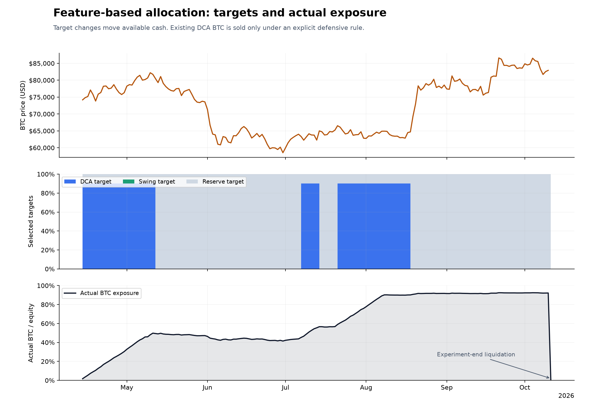
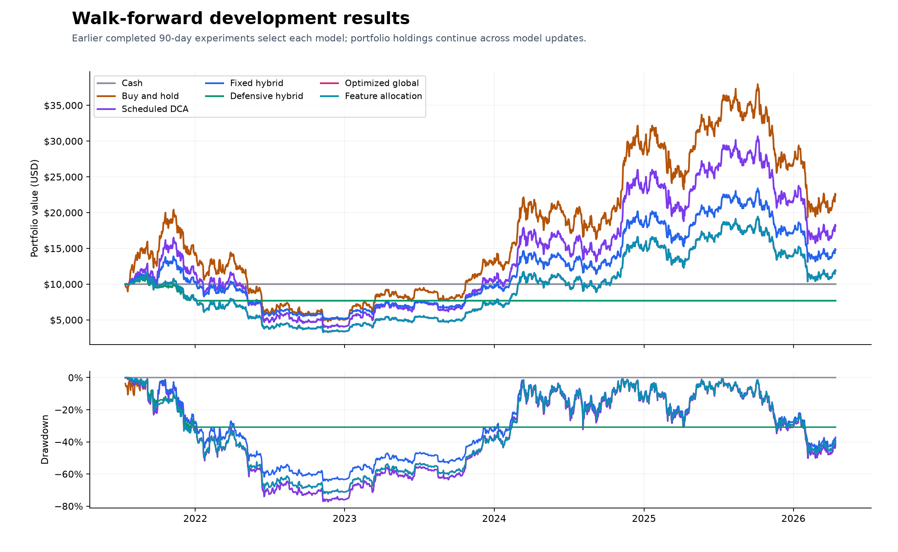
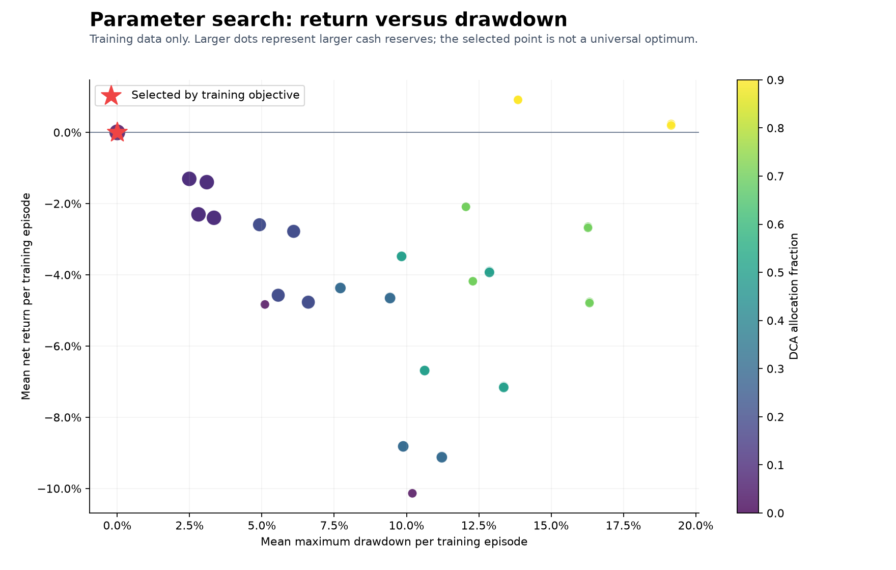

# Milestone 2: data, backtests, and allocation research

This milestone adds an offline research simulator and selection experiments. Trading-service execution, notifications, and deployment remain later milestones. The original persisted paper portfolio is independent of these experiments.

## What the experiment established

The feature-based selector had a 14.37% net return and 14.66% maximum drawdown in the final 180 days. Buy-and-hold returned 9.82% with 29.48% drawdown. This is an encouraging single-period observation.

The continuously carried development portfolio exposes a serious limitation: feature allocation had 72.30% maximum drawdown. Selecting more cash cannot reduce existing BTC exposure while selling remains restricted. The 25% pause blocks new purchases but leaves holdings exposed, and it can prevent participation in later recoveries. Cold-start 90-day training episodes therefore do not fully represent a portfolio with years of accumulated inventory.

The initial swing rule lost 20.64% in the holdout and paid $1,742.12 in modeled fees. Its trading activity is not justified by this experiment under the chosen cost assumptions. The frozen feature model had enough observations to specialize only for the mixed regime; other regimes use the global fallback.

These results support further research, not promotion of this selector into an operational policy. Milestone 3 must explicitly address existing-inventory exits, portfolio-aware allocation constraints, and pause/resume behavior. The current parameters were not changed after observing the holdout.

The holdout is now observed. Future strategy revisions may use it for diagnostics, but independent validation requires newly reserved data or future forward operation; it cannot be presented as an untouched test of those revisions.

## Research premise

We assume Bitcoin remains operational and tradable. We evaluate whether a configurable DCA and trading system improves returns and drawdown relative to simpler strategies, including during prolonged declines.

## Data and chronology

- Source: Coinbase Exchange public BTC-USD hourly candles.
- Coverage: 2020-01-01T00:00:00+00:00 through 2026-10-10T23:00:00+00:00.
- Candles: 59,384; missing hours: 16; invalid rows: 0.
- Research warm-up starts before 2020-07-19T00:00:00+00:00; development starts 2021-07-14T00:00:00+00:00.
- Sealed holdout: 2026-04-14T00:00:00+00:00 to 2026-10-11T00:00:00+00:00 (exclusive).
- Input SHA-256: `31ae7877085693949570f3d343060c3340ffe8b292200001274b0816762c8080`.

Missing prices are not filled. Short hourly indicators restart after gaps and entries are blocked immediately across a gap. Daily range/volume features require 24 candles. Daily trend can use a verified final-hour close even if an earlier hour is missing. Daily context becomes available only after that UTC day ends.

## Allocation search

The predeclared search evaluates 47 distinct profiles: allocation weights, 3%/6% dip thresholds, 1.5/2.5 ATR multipliers, and an optional defensive DCA exit. All-cash is a valid candidate. A seven-day confirmed bearish daily trend triggers the optional DCA exit; it uses a 200-day moving average and 30-day momentum. These rules are candidates, not validated defaults for deployment.

There are 23 nonoverlapping 90-day development experiments. Each starts with $10,000 and includes final liquidation costs. Rankings use up to two years of prior episodes. The score is mean log return minus 0.75 times mean maximum drawdown. That penalty expresses a research preference, not a mathematically unique definition of "best." `objective_sensitivity.csv` compares training selections with alternative penalties; holdout results are not used to choose the penalty.

The global selector uses all eligible earlier episodes. The feature selector uses the starting market regime (bull, bear, mixed, or high volatility), requiring at least three earlier matching episodes, and otherwise falls back to the global selector. It made 9 regime-based and 17 fallback decisions during the holdout. This is a coarse context model; the small historical sample limits its credibility.

Development uses 20 chronological model fits. Only experiments whose outcomes end before or at each fit time are eligible. The final model was frozen before the holdout and never refitted using holdout outcomes. Allocation targets are reviewed weekly; inventory continues between reviews. Targets redistribute available cash, without forcing a DCA sale. A reserve target is not guaranteed when existing BTC exceeds the permitted target.

## Sealed holdout results

| Strategy | Net return | Max drawdown | Final USD | Fees USD | Fills |
| --- | ---: | ---: | ---: | ---: | ---: |
| Cash | 0.00% | 0.00% | 10,000.00 | 0.00 | 0 |
| Buy and hold | 9.82% | 29.48% | 10,981.91 | 125.93 | 2 |
| Scheduled DCA | 6.54% | 26.90% | 10,654.37 | 123.95 | 51 |
| Dip DCA | 6.54% | 26.90% | 10,654.37 | 123.95 | 51 |
| Swing only | -20.64% | 20.64% | 7,935.95 | 1,742.12 | 136 |
| Fixed hybrid | -3.42% | 21.51% | 9,658.43 | 843.33 | 189 |
| Defensive hybrid | 4.41% | 11.92% | 10,440.87 | 962.48 | 227 |
| Optimized global | 0.00% | 0.00% | 10,000.00 | 0.00 | 0 |
| Feature allocation | 14.37% | 14.66% | 11,436.56 | 117.83 | 54 |

The feature selector's return difference is +14.37% versus the global selector and +17.78% versus the fixed hybrid. Compare drawdown and exposure too; a return difference alone does not establish superiority. Treat this as one historical holdout, not proof of future profitability.

## Development results

| Strategy | Net return | Max drawdown | Final USD | Fees USD | Fills |
| --- | ---: | ---: | ---: | ---: | ---: |
| Cash | 0.00% | 0.00% | 10,000.00 | 0.00 | 0 |
| Buy and hold | 124.26% | 77.22% | 22,426.44 | 195.01 | 2 |
| Scheduled DCA | 81.26% | 77.22% | 18,125.99 | 169.05 | 51 |
| Dip DCA | 81.08% | 77.22% | 18,108.45 | 168.95 | 51 |
| Swing only | -24.56% | 25.24% | 7,543.67 | 2,575.18 | 266 |
| Fixed hybrid | 48.07% | 64.45% | 14,806.68 | 915.63 | 167 |
| Defensive hybrid | -23.18% | 31.31% | 7,682.00 | 850.30 | 218 |
| Optimized global | 18.69% | 72.30% | 11,869.40 | 228.22 | 107 |
| Feature allocation | 18.69% | 72.30% | 11,869.40 | 228.22 | 107 |

Development is useful for understanding behavior, but its aggregate results are not a second untouched final test.

## Prolonged decline check: 2022

The following figures come from each continuously carried development portfolio during 2022; starting inventories differ because of earlier strategy decisions. They are an explanation of path dependence, not fresh equal-cash annual experiments.

| Strategy | 2022 return | Within-year drawdown |
| --- | ---: | ---: |
| Cash | 0.00% | 0.00% |
| Buy and hold | -64.35% | 67.44% |
| Scheduled DCA | -64.35% | 67.44% |
| Dip DCA | -64.35% | 67.44% |
| Swing only | -11.98% | 12.31% |
| Fixed hybrid | -49.14% | 51.93% |
| Defensive hybrid | -0.25% | 2.62% |
| Optimized global | -56.61% | 59.58% |
| Feature allocation | -56.61% | 59.58% |

## Search tradeoffs

Candidates, trial outcomes, rankings, frozen models, weekly decisions, annual results, application settings and research settings are included as CSV/JSON files beside this report. Large hourly feature, equity-curve and fill exports are generated locally and excluded from Git; the README documents how to regenerate them for the independent export audit.

## Independent verification

The independent export audit passed for 18 strategy-period comparisons. It checked the input checksum, training cutoffs, frozen holdout model dates, cash and inventory reconciliation, nonnegative cash, and allocation totals. See `verification.json`. Of 18 swing profit-target exits, 4 still lost money after modeled costs. A price target above entry therefore does not necessarily mean a profitable trade.

## Execution assumptions and limits

- Signals use completed candles and entries execute at the following available open. No entries are made across missing hours.
- Simulated per-fill fees are 0.6% and adverse slippage is 0.1%; these values are saved in `application_settings.json`. They are scenario assumptions, not a verified exchange fee tier. Cash earns zero interest.
- Swing size accounts for estimated entry/exit fees and normal slippage. Gaps can produce larger losses.
- Hourly bars cannot establish the ordering of intrabar prices. If both swing exits are touched, the simulator assumes the stop happens first. Protection is not a simulation of a five-second quote feed or an order book.
- The portfolio drawdown pause is checked at hourly open/close observations, latches for the experiment, and blocks new buys. It does not cap loss or automatically liquidate DCA.
- Simple buy-and-hold and DCA benchmarks have no portfolio pause. Hybrids and swing trading do. DCA cash spending caps and cooldowns still apply.
- New allocation targets move only uncommitted cash. A previously accumulated DCA position can exceed a reduced target until an explicit defensive rule exits it.
- Changing a profile updates the DCA tranche reference; an unchanged profile keeps its original reference. Spending history and cooldowns continue across allocation changes.
- Each complete experiment liquidates holdings at its final close with modeled costs. Intermediate weekly/model changes do not liquidate holdings.
- Offline research uses floating-point arithmetic with invariant checks. The operational broker, decimal accounting, partial fills, exchange minimum sizes, and restart recovery will be implemented in milestone 3.
- Hyperparameter selection can overfit even with chronological evaluation. Fixed search choices, sparse regimes, one venue, and one final test limit what these results show. No settings are automatically applied to the saved paper portfolio.

## Next review gate

Milestone 2 stops after verification and owner review. Milestone 3 will turn the reviewed rules into the operational paper engine, refine execution realism, and add explicit stress paths for prolonged declines and failed execution. LLM and connected reporting remain milestone 4.

## Sources

- [Coinbase candle schema, limits, and incomplete historical data](https://docs.cdp.coinbase.com/api-reference/exchange-api/rest-api/products/get-product-candles)
- [Chronological validation](https://scikit-learn.org/stable/modules/generated/sklearn.model_selection.TimeSeriesSplit.html)
