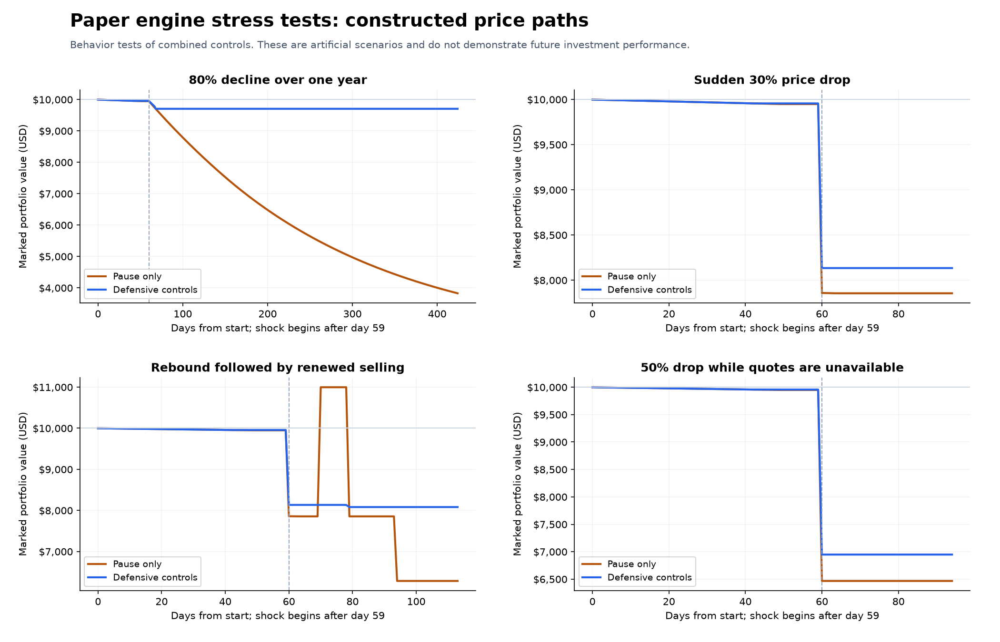

# Milestone 3: persistent paper engine and risk controls

The operational paper engine runs on public data and simulated capital. The searched milestone-2 policy remains research-only. Runtime targets and risk limits are explicit experimental configuration; these stress tests do not establish an optimal investment policy.

## Delivered behavior

- Decimal balances, price/quantity increments, minimum order amounts, conservative rounding, and cost-aware swing targets.
- Atomic quote processing with order reservations, partial fills, cancellation, persisted protective exits, and replay/restart protection.
- Existing-inventory liquidation for confirmed bear conditions, rapid declines, portfolio drawdown, or a lifetime capital-floor breach.
- Limits on new BTC exposure and cash depletion, plus trimming of appreciating holdings.
- A cooldown and distinct-day recovery confirmation before automatic resume. Lifetime drawdown and the initial-capital floor survive a resume. Capital-floor breaches stay halted.
- A public-data service that polls quotes independently of its background candle/features refresh. Optional continuous mode is available; bounded demos have stopped.
- A [modeling guide](../../docs/modeling-guide.md) with equations and examples drawn from the saved research and actual paper fill.

## Public-data run and restart

The first demo completed 3 cycles, accepted 2 observations, and created 1 simulated fill. The restart completed 2 cycles, accepted 2 observations, and created 0 new fills. The existing DCA position persisted.

Current simulated cash is $9,900.03; BTC is `0.00119731`. The last marked equity is $9,999.38474140. Cumulative fees are $0.60. Independent cash reconciliation difference is **$0.00**. These few observations demonstrate connectivity and state handling, not trading performance or the required week-long evaluation.

The public product response used a BTC increment of `1E-8`, USD price increment `0.01`, and minimum order notional `$1`. Test fixtures separately use a conservative $10 minimum. Fee/slippage values remain simulation assumptions.

## Constructed stress results

| Constructed scenario | Pause-only return | Defensive return | Defensive final state |
| --- | ---: | ---: | --- |
| 80% decline over one year | -61.72% | -2.95% | cooldown |
| Sudden 30% drop | -21.45% | -18.66% | cooldown |
| Rebound followed by further decline | -37.16% | -19.18% | cooldown |
| 50% drop with a quote outage | -35.33% | -30.52% | halted |



Every scenario uses the same persistent engine and every ledger reconciles exactly. The comparisons start with common 70/20/10 sleeve targets, but the defensive policy limits pre-shock BTC exposure to about 60% while the pause-only policy reaches about 70%. The baseline also reallocates idle cash as prices decline. The resulting difference is a combination of exposure caps, entry suspensions, exits, and recovery rules. The quote paths are artificial and exits assume the configured paper fill capacity. This is not an isolated causal estimate of any single rule or a return forecast.

The outage case ended below the configured 30% capital-loss trigger: gaps and unavailable quotes can move prices past a threshold before the engine can act. The false rebound caused an additional loss after one qualified recovery, while lifetime drawdown remained visible. The permanent halt is intentionally not an automatic license to try again with a reset budget.

## Files and verification

- `stress_summary.json` / CSV: exact assumptions, all case metrics, individual ledger audits, and SQLite evidence locations.
- `live-demo.json` / `restart-demo.json`: bounded real-data run summaries.
- `verification.json`: actual first fill, current portfolio, ledger reconciliation, and unchanged original research input checksum.
- `operational_events.json`: human-inspectable event trace for the public-data demo.
- `config/paper.json`: parameterized runtime control policy; swing entries default to disabled.
- `test-results.json`: the recorded final check on 2026-10-11; 53 tests passed with zero failures/errors.

The original milestone-2 dataset and the foundational simulated portfolio are separate from the operational database. The historical holdout is still treated as observed data; these new controls require independent future evaluation.

## Run it

```powershell
.\.venv\Scripts\python.exe -m bitcoin_agent paper-status
.\.venv\Scripts\python.exe -m bitcoin_agent paper-audit
.\.venv\Scripts\python.exe -m bitcoin_agent run-paper --cycles 3
```

`run-paper --cycles 0` runs until Ctrl+C. No background service was left running at this milestone's review stop. The new operational database is `var/operational.sqlite3`; the original `var/paper.sqlite3` remains the foundation example. Public APIs receive GET requests only; no funded broker or real order submission is implemented.

## Next milestone

Stop for owner review. Milestone 4 adds validated Google Sheet configuration/cache, bounded LLM experiments, Telegram notifications, and weekly Gmail reporting. Continuous seven-day evaluation and deployment remain milestone 5.
